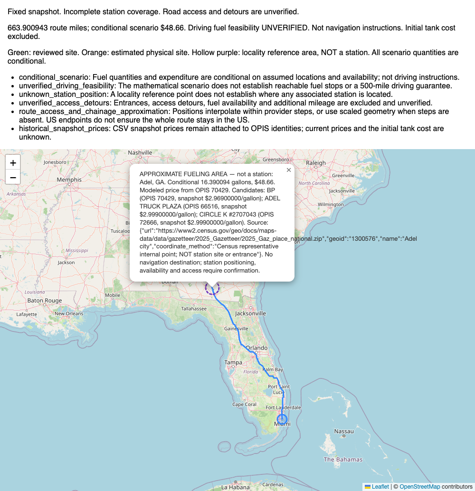
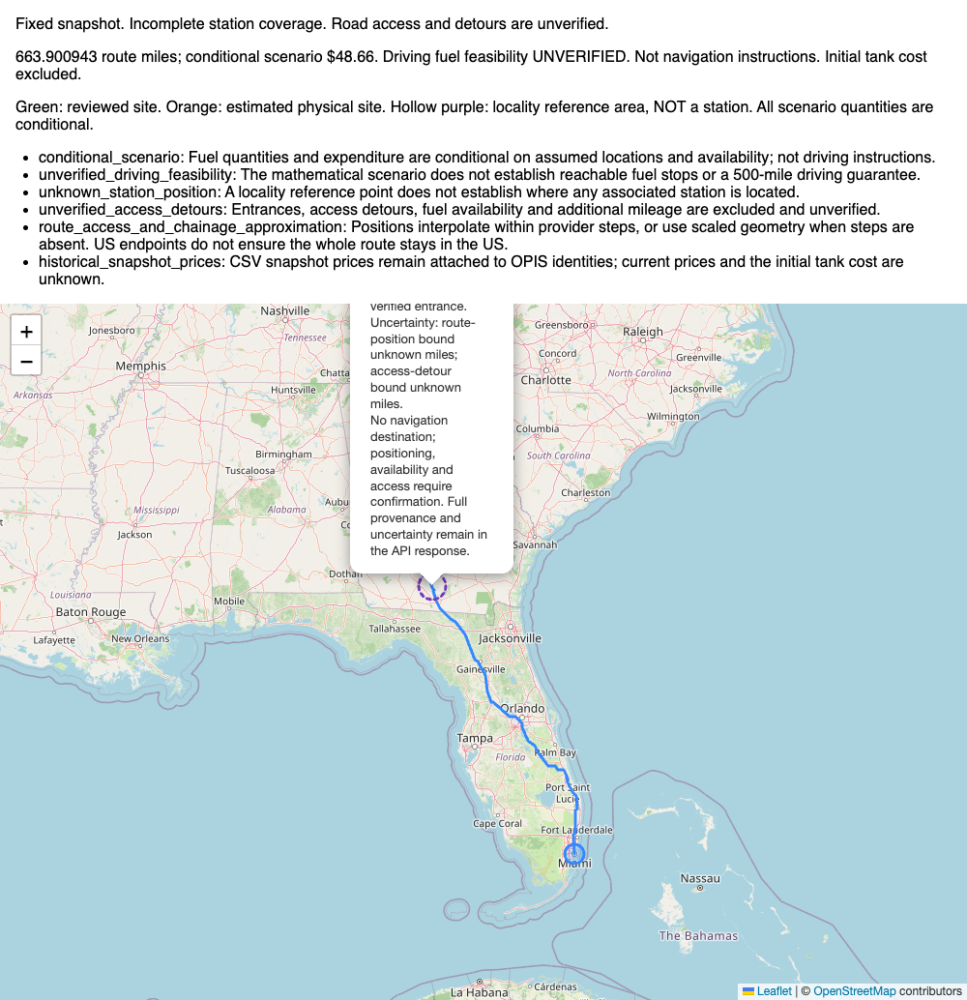

# Bounded live Atlanta–Miami fallback verification

## Checkpoint and execution

Local commit **3fd0cf4** (`feat: add opt-in conditional fuel planning with offline
locality hints`) contains only the 13 feature code/data/test/documentation files.
Pending New Mexico research, reviewed-import artifacts and submission/Loom drafts
were excluded. The commit is not pushed.

On October 10, 2026 at approximately 04:22 UTC, a cold POST through the actual
running Django WSGI/DRF application used:

```json
{"start":"Atlanta, GA","finish":"Miami, FL","allow_estimates":true}
```

The server used the existing development SQLite database opened **read-only**, the
local `.env` credential, and real Geoapify HTTP transport with retries disabled.
A global ledger reserved each attempt before sending and refused attempts above
three. Only the two specified US endpoint geocodes and one driving route were
permitted. No synthetic/recorded provider replies substituted for live responses.
Provider JSON was saved after receipt for offline analysis and map rendering.

## Actual route and provider usage

| Measurement | Observed |
| --- | --- |
| Cold API status / end-to-end latency | **200 / 6.889895 s** |
| Distance | **663.900943 miles**, provider distance **1,068,445 m** |
| Geometry | MultiLineString, **5,478 points** |
| Mileage method | **provider_steps**, interpolation within each step |
| Atlanta geocode | HTTP 200, **3.637304 s** |
| Miami geocode | HTTP 200, **0.936760 s** |
| Driving route | HTTP 200, **2.041538 s** |
| Attempts / retries / provider errors | **3 / 0 / 0** |
| Provider latency sum | **6.615602 s** |
| Estimated credits / authorized ceiling | **6 / 8**, actual account debit not exposed |
| Dataset revision | **2**, unchanged |

The geometry digest, full response and attempt ledger are preserved in the
[verification artifact](../data/best-effort-live-verification.json),
[API response](../data/best-effort-live-api-response.json) and
[usage ledger](../data/best-effort-live-provider-usage.json).
Saved endpoint/route provider replies are `data/best-effort-live-provider-response-{1,2,3}.json`.
Request URLs, credentials and headers were not captured. Expiring localhost map URLs
are omitted from the published response artifact; the running response included one.

## Strict versus best effort

An explicit `allow_estimates:false` request in the same running worker reused the
endpoint and route caches, returning **422 `insufficient_station_coverage`** in
**0.018128 s**. There are no approved station sites matched on this route.
A repeated opt-in request returned **200** in **0.070931 s** with the same scenario.
The provider ledger remained identical: **zero additional external attempts**.
The three-attempt budget is exhausted; no other route or provider request was made.

The best-effort response retains:

```json
{
  "planning_mode":"best_effort",
  "status":"estimated",
  "fuel_feasibility":"unverified",
  "fuel_stops":[],
  "total_fuel_cost":null,
  "gallons_purchased":null,
  "estimated_fuel_expenditure":"48.66"
}
```

It is a **mathematical purchasing scenario at assumed locality positions**, not
an actionable fuel-stop schedule or verified driving feasibility.

## Associated areas, identities and conditional purchase

The route matches **43 distinct locality hints associated with 102 OPIS records**;
zero verified sites and zero estimated physical stations participate. The largest
gap between all assumed candidate positions is **94.329115 miles**. Locality-point
offsets range from **0.069534 to 9.843323 miles**: the 10-mile search corridor is not
a station-location, road-access or uncertainty bound. All area positions/order,
offsets and associated IDs are listed in the verification artifact.

Global data remains six verified sites, no estimated physical records, 6,138
unresolved records with locality associations and 482 without hints. This is not
nationwide station-site or feasible-route coverage.

The optimizer models one purchase in **Adel, GA**, at assumed route mile
**204.603278** and locality-point offset **0.477280 mile**:

| Original CSV candidate identity | Snapshot price | Role |
| --- | ---: | --- |
| OPIS **70429**, BP, **SR-76**, Adel, GA | **$2.969/gallon** | Modeled lowest-price candidate |
| OPIS **66516**, ADEL TRUCK PLAZA, **I-75, EXIT 39**, Adel, GA | $2.999/gallon | Associated alternative |
| OPIS **72666**, CIRCLE K #2707043, **I-75/SR-401, EXIT 39 & SR-37**, Adel, GA | $2.999/gallon | Associated alternative |

The assumed point is the Census Adel internal reference point, **not any of these
station sites or entrances**. The price-bearing candidate's physical position,
availability and road access remain unknown. No price is transferred to another
station; each candidate retains its original OPIS identity and stored CSV price.

| Conditional quantity | Result |
| --- | ---: |
| Modeled purchase | **16.390094 gallons** |
| Conditional expenditure | **$48.66** (unrounded model $48.6621901222) |
| Modeled arrival inventory at Adel | **29.539672 gallons** |
| Modeled departure inventory | **45.929767 gallons** |
| Total route consumption | **66.390094 gallons** |
| Starting / ending inventory | **50 / 0 gallons** |
| Longest leg between purchase events/endpoints | **459.297665 miles** |
| Nominal range headroom on that leg | **40.702335 miles** |
| Negative intermediate modeled inventory | **None** |

An exact Decimal replay on the saved live geometry/provider step mileage verified
the area projections, price ownership, optimized cost and inventory conservation:
`50 + 16.390094349... - 66.390094349... = 0`. Full-precision quantities are in the
verification JSON; displayed quantities round to six decimals.

**Zero ending fuel is fragile.** Additional consumption from unmodeled access,
incorrect positioning or detours creates a deficit with these fixed quantities,
even though the nominal longest leg is below 500 miles. Station-position and access
bounds are unknown, so the conservative check reports `unknown`. The test establishes
no real-world guarantee. Initial tank cost is unknown and excluded; CSV prices are
historical snapshots. The optimizer objective and zero-reserve assumption are unchanged.

## Warnings preserved in API and browser

All six machine-readable warning codes and messages are present:

- `conditional_scenario`: quantities/expenditure depend on assumed positions and availability; not driving instructions.
- `unverified_driving_feasibility`: the mathematical scenario establishes neither reachable stops nor a 500-mile driving guarantee.
- `unknown_station_position`: a locality point does not establish associated station positions.
- `unverified_access_detours`: entrances, access, fuel availability and extra mileage are excluded/unverified.
- `route_access_and_chainage_approximation`: chainage interpolates within provider steps; US endpoints alone do not establish US-only route geometry.
- `historical_snapshot_prices`: prices stay attached to OPIS identities; current prices and initial-tank cost are unknown.

`complete_csv_coverage` remains false. Each purchased area carries original candidate
identities/prices, source GEOID/URL/method, null uncertainty bounds and
`navigation_destination:false`; actionable fuel stops and guaranteed purchase totals
remain empty/null. The response includes the strict failure and hint content version.

## Actual Leaflet browser rendering

Actual Chrome loaded real Leaflet 1.9.4 from already cached assets and rendered the
Django-produced HTML containing the **saved live response**. Geometry matched the
API response exactly. Both endpoint indicators and the hollow/dashed purple Adel
area indicator rendered. Its popup displayed all three CSV identities/prices,
conditional quantities/cost, Census provenance and the explicit “not a station”
label. There were **zero precise station pins**, all six warnings were visible,
the summary said **UNVERIFIED**, and OpenStreetMap attribution was visible.

**15 map-tile requests**, no console errors, no network failures or HTTP errors;
the browser made no Geoapify requests. This verifies visualization, not the identity
or accessibility of any associated station.

[Browser checks](../data/best-effort-live-browser-verification.json).



### Approved readable-popup delivery update

The original screenshot/checks above preserve the live-verification milestone.
The later presentation-only change renders source, locality, coordinate method
and uncertainty as readable labels; no API fields, optimizer or matching changed.
Actual Chrome replay of the saved live response checked the new popup, exact route,
cost, all warnings and identities/prices. Final replay loaded 15 tiles with zero
console/network errors and no new Geoapify calls. The initial bounded browser
harness blocked three extra tile requests when the open popup auto-panned; the
final passive screenshot disabled auto-pan in the harness, without changing the
application, to stay within the tile budget.

[Readable-popup browser checks](../data/best-effort-readable-popup-browser-verification.json).



The committed offline regression imports only the original CSV and approved six-site
artifact, loads the committed locality snapshot and replays the three original
Atlanta–Miami provider responses. It proves strict 422 and an exactly matching
conditional contract, identity-specific prices, inventory and no ORM changes. The
shortened independent-review JSON is excluded from the delivery commits; all full
geometry/provider payloads remain available for reproducibility.

## Readiness and remaining gates

No application defects requiring changes were identified. The fallback is ready
for inclusion as an explicitly opt-in, conditional area/price scenario. It does not
resolve arbitrary-US verified fuel-stop coverage, and must not replace the strict
reviewed-corridor demonstration or imply that $48.66 is a guaranteed travel cost.

Final verification passed **223 working-tree tests in 3.28 seconds**. Ruff,
changed-Python formatting, Django system checks, migration-drift and diff checks
passed. A separate archived checkout installed locked dependencies from the local
cache without downloads and passed **211 committed tests in 2.70 seconds** plus Ruff;
the 12-test difference consists of pending unrelated research tests. The committed
feature works independently of those files. Database, optimizer, approved coordinate
artifacts and submission drafts remain byte-for-byte unchanged: six accepted and
6,620 pending stations, dataset revision 2. Credential/URL scans passed.
Live evidence/report files are intentionally uncommitted for review; no push occurred.

Remaining delivery tasks: review/checkpoint these live artifacts, approve the push,
reconcile README/Postman/Loom instructions with the optional contract, confirm private
GitHub reviewer access, record the under-five-minute walkthrough, and submit before
**October 11, 2026, 16:55 GMT−3 (19:55 UTC)**. No recording, submission or permission
changes were made during this verification.
