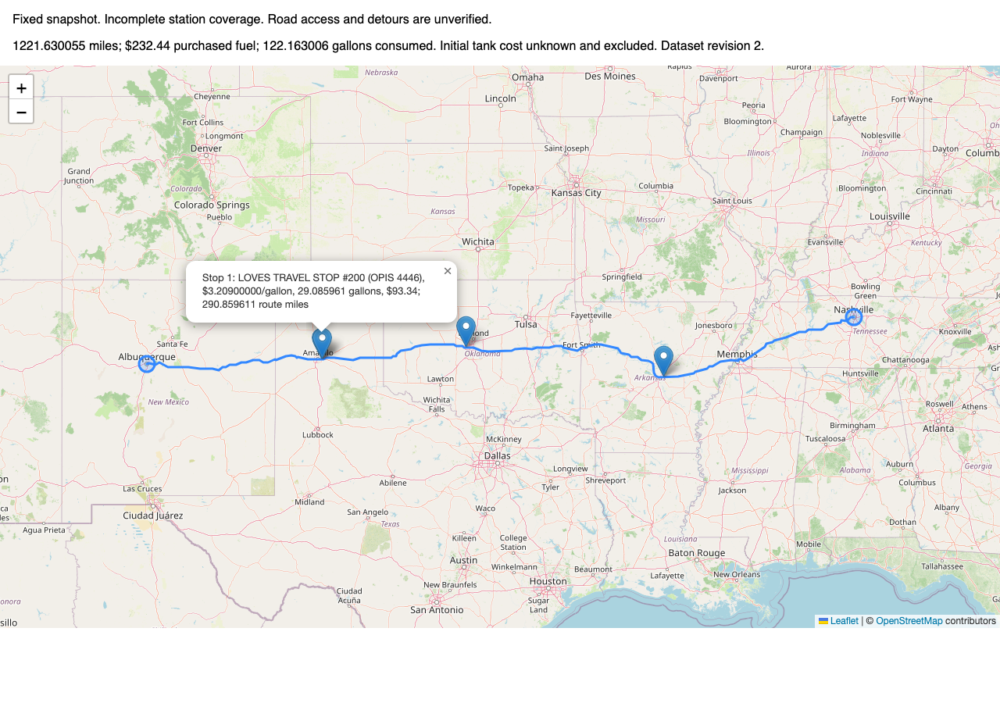
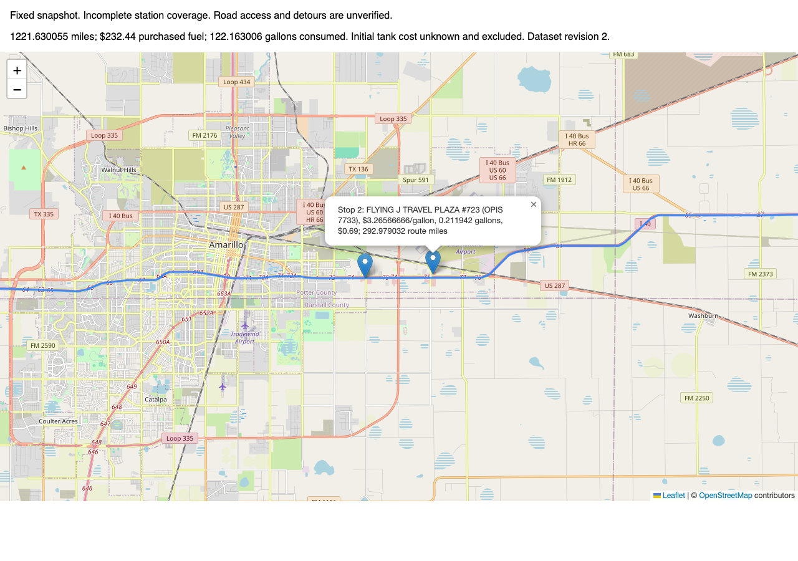

# Final live, browser and fresh-setup verification

Delivery review: see [assignment compliance and scoped issue completion](submission-readiness.md)
and the [4:45 Loom draft](loom-walkthrough.md). This report records the earlier
verification milestone; its final pending-work notes are historical. No additional
live verification was performed during delivery preparation.

## Published checkpoint

Normal feature-branch push to the intended private GitHub repository published
**d714375** (investigation/rounding fix) and **91ef6cb** (dry-run import, recorded
corridor regression and integration documentation). GitHub confirmed both exact
hashes. No main push, squash, reset or history rewrite occurred.

[Feature branch](https://github.com/gns17/routing-assessment-project/tree/feat/assessment-implementation).

## One cold running-application request

POSTed Albuquerque, NM → Nashville, TN through a real local Django WSGI/DRF server,
with empty process-local caches and the actual six-reviewed-station SQLite DB.
Provider responses were live: no recorded/mocked reply substituted. A transport
wrapper counted attempts globally, allowed only endpoint geocoding/driving routing,
set retries=0 and rejected further attempts after three. Instrumentation saved no
keys or credential-bearing URLs. External requests outside this route were not made.

| Metric | Result |
| --- | --- |
| API status | 200 |
| Complete API response latency | **4.522191 s** |
| Endpoint geocode latencies | 1.3702 s / 0.5650 s |
| Driving-route latency | 2.4316 s |
| Provider HTTP total | 4.3668 s |
| Geoapify attempts / retries | **3 / 0**, all HTTP 200 |
| Estimated credits / reserved allowance | 6 / 8; actual debit unavailable |
| Distance / mileage source | **1,221.630055 miles / provider_steps** |
| Database revision | **2** |
| Reviewed stations matched | **6** |
| Largest eligible-network gap | **350.879358 miles** |
| Largest leg between actual purchases | **350.979690 miles** |
| Purchases / expenditure | **4 / $232.44** |
| Consumed / purchased fuel | **122.163006 / 72.163006 gallons** |
| Ending fuel / initial tank cost | 0 gallons / unknown, excluded |

All displayed route/stop/price/inventory/cost/coverage fields and the complete
geometry exactly match the saved-response regression. Declared comparison tolerances
were 0.000001 mile/gallon and $0.01; observed differences were zero at displayed
precision. Capacity/inventory conservation checks pass. No unexpected/substantial
provider discrepancy occurred, so no fallback response was used.

The live API directly confirms four selected purchase positions/offsets; all six
station offsets/order were separately verified against the identical geometry and
recorded normalized step mileage in the ORM regression. Offsets are approximately
0.0452, 0.0721, 0.0906, 0.1694, 0.2481, 0.2492 mile in route order. No coordinate,
price or dataset revision changed during verification.

Evidence: [response](../data/final-live-api-response.json),
[attempt ledger](../data/final-live-provider-usage.json),
[comparison/conservation](../data/final-live-verification.json).
The three-attempt budget is exhausted; browser/map rechecks made no Geoapify calls.

## Actual browser, not SDK stub

Used a fresh headless Chrome profile with real Leaflet **1.9.4**, real CSS/marker
assets and OSM tiles. Browser request interception allowed only localhost, unpkg
Leaflet assets and OSM tiles; background networking was disabled. Inspected rendered
SVG route, visible tiles, actual Leaflet layer objects, endpoint markers and all four
purchase marker popups. Each popup shows station identity/OPIS ID, CSV price per
gallon, fuel quantity, purchase cost and mileage; summary shows $232.44 and initial
tank exclusion. Required OpenStreetMap attribution is visible.

Template review found an omitted popup price before the first browser pass; that
pass then found an absent favicon request. Added the existing API price to popup text
and a data-URI favicon. These are narrow display fixes, not objective/architecture
changes. The original favicon 404 is preserved in
[initial browser evidence](../data/final-browser-verification-initial.json).
Final browser checks have **zero console exceptions/errors, zero request failures,
and zero HTTP errors**. The overview loaded 24 tiles. Two Amarillo markers overlap
at overview scale, as expected for stops 2.12 miles apart; detail zoom confirms both
separately, including the 0.211942-gallon purchase. No artificial visualization data.

[Browser evidence](../data/final-browser-verification.json).

## Isolated reviewer setup

Exported commit **91ef6cb** into a fresh temporary checkout: no .venv, SQLite DB or
.env copied. `uv sync --locked --offline` created its own Python 3.13.16 environment
and installed 19 packages from the existing package cache, without network downloads.
Applied all migrations to its empty SQLite DB. Original CSV import created 6,626
US rows (620 Canadian rows excluded), revision 1; reviewed coordinate dry run/import
accepted exactly six, revision 2. Django checks passed.

Started actual Django `runserver --noreload` in the isolated checkout and POSTed over
HTTP. Its provider transport explicitly replayed committed real responses to avoid
spending another live budget. It returned **200 in 0.101339 s**, with expected geometry,
fuel plan, revision and prices matching the separately live response. Path guards
confirmed use of its own new DB; no original local DB/.env access. This validates
fresh setup and running pipeline, not an additional live-provider run. A fresh live
reviewer request requires the reviewer's own Geoapify key, as documented in README.

The fresh checkout also passed **148 tests**, Ruff lint and migration-drift checks.
[Fresh setup evidence](../data/final-fresh-setup-verification.json).

## Acceptance review and remaining work

GNS-8 implementation criteria are evidenced: projected ORM candidates/current
fingerprint eligibility, indexed filtering, two SELECTs, consistent snapshots,
geometry/loops/boundaries, actual measured behavior and honest failures. The one-mile
assessment default is conservative for these six reviewed sites: maximum observed
offset <0.25 mile; 0.1 mile is infeasible, 0.25 fragile, 0.5/1 mile agree. This justifies
its use for the reviewed corridor, not national calibration or verified access.

GNS-10 implementation criteria are evidenced: real cold request, GeoJSON/totals/stops,
revision-aware caching, visible attributed Leaflet map and bounded backend calls.
Both issues are ready for completion review for the approved limited-coverage scope;
no Linear scope/status edits were made in this verification task.

Remaining limitations: six of 6,626 source stations are resolved; unsupported routes
fail honestly; prices are a fixed optimistic snapshot; station entrances/access and
detours are unverified; interpolation is approximate; initial fuel cost excluded;
0.212-gallon purchase can be impractical under zero stop penalties. No nationwide or
road-network-global optimum is claimed. Routes/plan caches are process-local, local
map snapshots expire; multi-host serving is outside scope.

Before Loom: checkpoint/publish the narrow display fixes and final evidence/README,
finalize issue completion review and GNS-11 submission checks, prepare a <=5-minute
API/map/code walkthrough that explicitly states these limits. No Loom recording or
assessment submission has been performed. No extra Geoapify verification budget is
needed for correctness; a later cold demonstration requires separate live approval.
