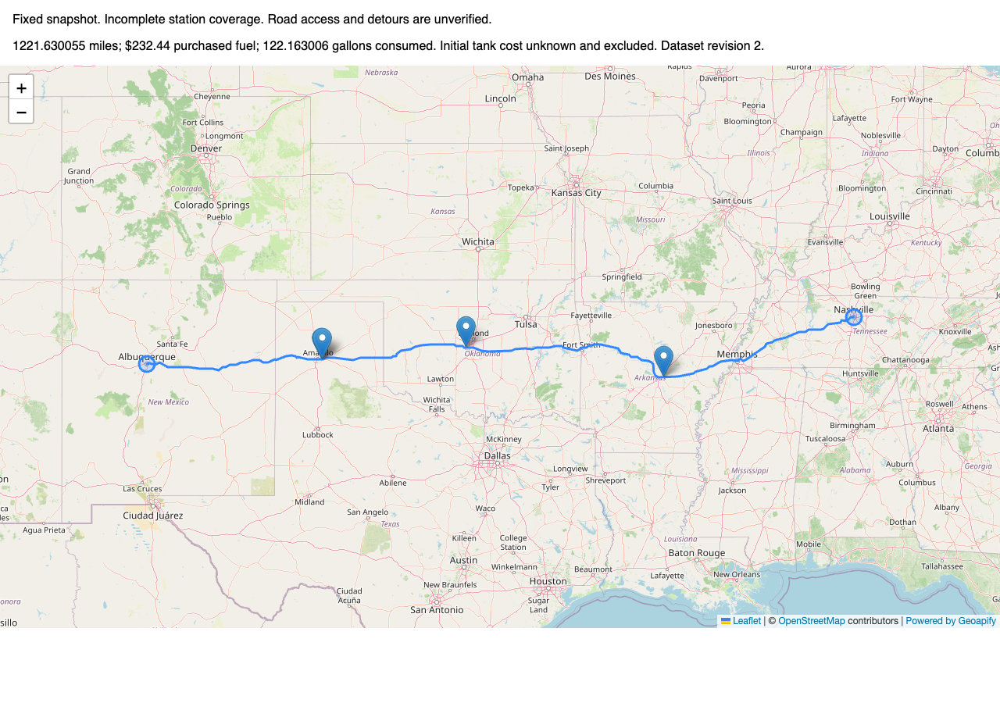
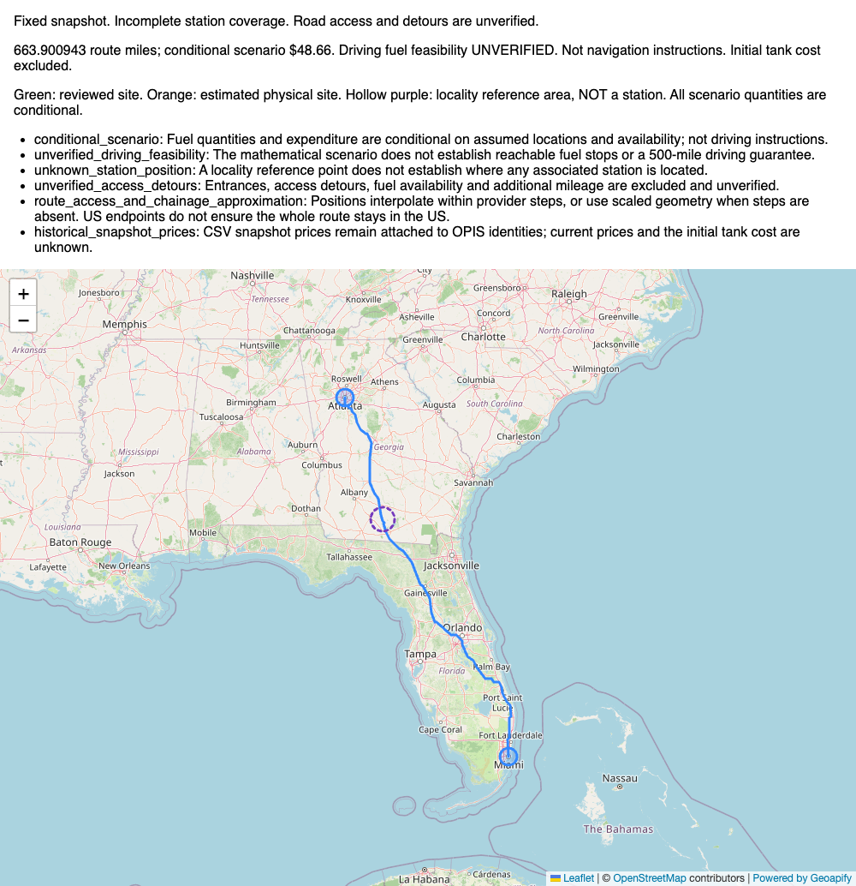

# Map attribution correction — recorded replay

The shared Leaflet control now displays the existing **© OpenStreetMap contributors**
credit alongside **Powered by Geoapify**, linking to `https://www.geoapify.com/`.
The provider link uses `target="_blank"` and `rel="noopener noreferrer"` with no
`nofollow`. Both strict and best-effort modes use the same static credit, outside
popups. Routing, matcher, optimizer, API fields and map behavior are unchanged.

Two regression cases check actual map responses, both credit links, safe attributes
and exact preservation of the embedded API payload. Actual Chrome/Leaflet 1.9.4
also rendered both saved live responses: exact geometry, four strict purchase pins
or one hollow Adel-area indicator, unchanged $232.44/$48.66 summaries, and visible
OSM/Geoapify credits. Final browser checks had zero console/network errors.

**This is recorded replay, not another live Geoapify verification.** Sources are
`data/final-live-api-response.json` and `data/best-effort-live-api-response.json`.
Leaflet/icons and the final 24 strict / 15 best-effort tiles came from cached assets.
The screenshot harness initially reused tile filenames incorrectly; visual inspection
rejected those renders. A bounded normal OSM refresh made 40 tile requests (not
Geoapify requests); its viewport transition reached the cap. Correcting the local
URL-to-file cache mapping and using the original viewport sizes then produced the
fully verified cached replay, with no external requests in the final pass. This was
a verification-harness correction, not an application or route-geometry change.

Original screenshots/reports remain historical evidence. These new images show only
the current presentation of unchanged saved route/planning data:

[Machine-readable browser checks](../data/map-attribution-verification.json).
Provider reuse/attribution terms and upstream data notices are in the
[fixture index](../data/README.md). No third-party data ownership or new license is claimed.
